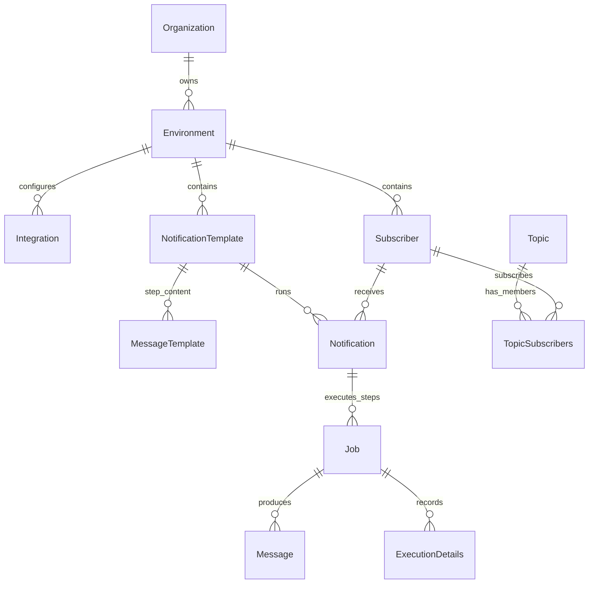

# Data Models

Novu uses MongoDB for operational state, Redis/BullMQ or SQS for job transport, and ClickHouse for analytics/debug history.

## Datastores

- MongoDB: primary source of truth for tenants, environments, workflows, subscribers, integrations, notifications, jobs, messages, and execution details. Schemas live in `libs/dal/src/repositories`.
- Redis: queue backend for BullMQ and cache/in-memory services. Queue setup lives in `libs/application-generic/src/services/queues` and `libs/application-generic/src/services/bull-mq`.
- SQS: alternate/migration queue backend in `libs/application-generic/src/services/sqs`.
- ClickHouse: workflow run, step run, trace, request, and aggregate tables. Schemas live under `libs/application-generic/src/services/analytic-logs`; migrations live in `apps/api/migrations/clickhouse-migrations`.

## Major Mongo Models

### Organization

File: `libs/dal/src/repositories/organization/organization.schema.ts`

Represents the tenant/account. Stores `name`, `logo`, service level/trial fields, branding, locales, domain/language settings, external IDs, Stripe customer ID, and onboarding state.

### Environment

File: `libs/dal/src/repositories/environment/environment.schema.ts`

Represents a runtime boundary inside an organization. Stores `identifier`, `_organizationId`, `apiKeys`, API rate limits, widget config, DNS config, bridge/echo URLs, webhook app ID, parent environment, color, and type.

Important hidden logic: `apiKeys.key` is encrypted, `apiKeys.hash` is used for lookup, and indexes exist for both.

### Integration

File: `libs/dal/src/repositories/integration/integration.schema.ts`

Represents provider configuration for one environment. Important fields: `providerId`, `channel`, encrypted `credentials`, `configurations`, `active`, `primary`, `identifier`, `priority`, `conditions`, and `connected`.

Provider credentials are decrypted by `GetDecryptedIntegrations.getDecryptedCredentials()` before provider construction.

### Subscriber

File: `libs/dal/src/repositories/subscriber/subscriber.schema.ts`

Represents the recipient identity known by the customer. Important fields: `subscriberId`, `_environmentId`, `_organizationId`, `email`, `phone`, `firstName`, `lastName`, `avatar`, `locale`, `timezone`, `data`, `isOnline`, `lastOnlineAt`.

Important constraint: unique partial index on `subscriberId + _environmentId` for non-deleted subscribers.

### Topic and TopicSubscribers

Files:

- `libs/dal/src/repositories/topic/topic.schema.ts`
- `libs/dal/src/repositories/topic/topic-subscribers.schema.ts`

`Topic` stores `_environmentId`, `_organizationId`, `key`, and `name`. `TopicSubscribers` stores the membership relation, including `_subscriberId`, `_topicId`, `topicKey`, `externalSubscriberId`, and `contextKeys`.

### NotificationTemplate

File: `libs/dal/src/repositories/notification-template/notification-template.schema.ts`

This is the workflow model. Important fields: `name`, `active`, `draft`, `critical`, `triggers`, `steps`, `preferenceSettings`, `origin`, `status`, publish metadata, payload schema/validation flags, translation flag, issues, severity, and tenant/environment/org fields.

Important constraint: indexes on `_environmentId + triggers.identifier` support trigger lookup.

### MessageTemplate

File: `libs/dal/src/repositories/message-template/message-template.schema.ts`

This is the content/config for a step. Fields include `type`, `name`, `stepId`, `subject`, `content`, `contentType`, `title`, `cta`, `preheader`, `senderName`, `_layoutId`, `_feedId`, `controls`, `output`, `code`, and `stepResolverHash`.

### Notification

File: `libs/dal/src/repositories/notification/notification.schema.ts`

Represents one workflow run for one subscriber. Stores `_templateId`, `_subscriberId`, `transactionId`, `channels`, `topics`, `to`, `payload`, `controls`, `tags`, `severity`, `critical`, and `contextKeys`.

`CreateNotificationJobs.createNotification()` creates this record and then attempts to create a ClickHouse workflow run.

### Job

File: `libs/dal/src/repositories/job/job.schema.ts`

Represents one step execution. Important fields: `status`, `deliveryLifecycleState`, `payload`, `overrides`, `tenant`, `step`, `_notificationId`, `transactionId`, `subscriberId`, `_subscriberId`, `_parentId`, `type`, `providerId`, `digest`, `preferences`, and `scheduleExtensionsCount`.

Hidden logic:

- `JobStatusEnum` includes `pending`, `queued`, `running`, `completed`, `failed`, `delayed`, `canceled`, `merged`, and `skipped`.
- A partial unique digest index prevents two delayed digest master jobs for the same digest key/value/template/subscriber/environment in the guarded state.

### Message

File: `libs/dal/src/repositories/message/message.schema.ts`

Represents an actual channel output and inbox item. Stores `_notificationId`, `_jobId`, `_subscriberId`, `channel`, `providerId`, provider `identifier`, content fields, delivery/read/seen/archive/snooze state, `payload`, `data`, `overrides`, `tags`, `severity`, `channelData`, and `contextKeys`.

### ExecutionDetails

File: `libs/dal/src/repositories/execution-details/execution-details.schema.ts`

Represents debug/delivery detail rows. Stores `_jobId`, `_notificationId`, `_messageId`, `providerId`, `transactionId`, `channel`, `detail`, `source`, `status`, `raw`, and `webhookStatus`.

## ClickHouse Models

Migration: `apps/api/migrations/clickhouse-migrations/1_initial_schema.sql`

- `workflow_runs`: complete workflow run state, maps `workflow_run_id` to `NotificationEntity._id`.
- `step_runs`: step/job execution state, maps `step_run_id` to `JobEntity._id`.
- `traces`: event traces for requests, workflow runs, and step runs.
- `requests`: HTTP request logs.

The TypeScript schema files mirror these tables:

- `workflow-run.schema.ts`
- `step-run.schema.ts`
- `trace-log.schema.ts`
- `request-log.schema.ts`
- aggregate tables such as `workflow-run-count` and `delivery-trend-counts`.

## ER Diagram

## Important Constraints

- Most operational queries must include `_organizationId` and `_environmentId`. Missing either is a tenant isolation risk.
- `transactionId` is used for trigger correlation and duplicate detection in `TriggerEvent`, but queue retries can still re-run work after a worker failure.
- Provider credentials live on `Integration.credentials`; API keys live on `Environment.apiKeys`. Both use encryption helpers in `libs/application-generic/src/encryption`.
- Message state is not the same as job state. A job may fail before a message exists, and a provider webhook may later update execution details for a message identifier.

